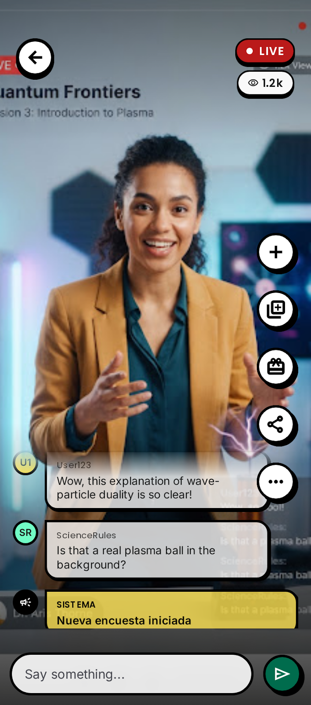
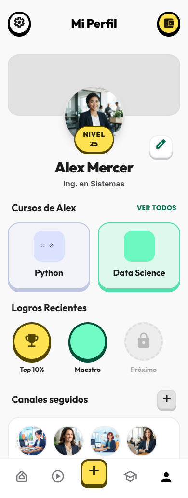
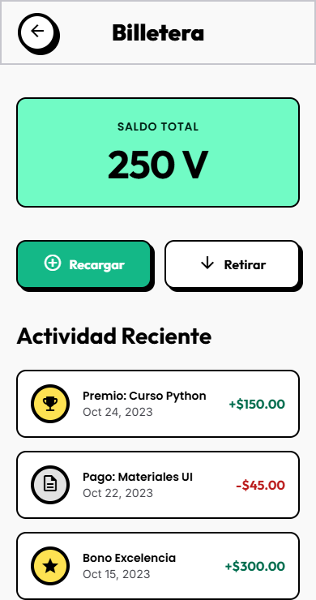
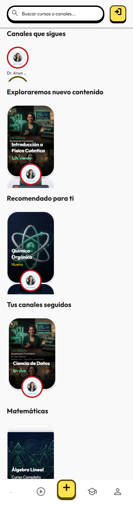
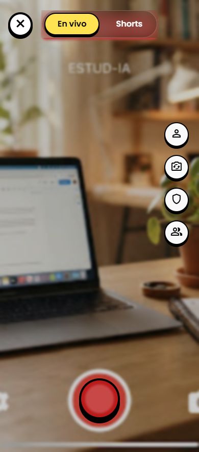

# Design system de la landing

**Principio:** la landing tiene la **identidad táctil de la app** (bordes negros, sombras duras,
amarillo y esmeralda) con la **coreografía de Bulletproof** (tipografía gigante, scroll suave,
secciones fijas). Ver [`../07-referencias/estudio-bulletproof.md`](../07-referencias/estudio-bulletproof.md)
y [`../07-referencias/estudio-app-2026-11-17.md`](../07-referencias/estudio-app-2026-11-17.md).

**Fuente de los tokens:** `streaming-estudia/Frontend/lib/src/shared/theme/app_colors.dart` y
`streaming-estudia/docs/05-diseno/design-system.md` (sección "Estilo táctil"), consultados el
2026-11-17. Si la app cambia su paleta, se actualiza aquí y en `src/styles/tokens.css`.

## Colores

| Token | Valor | Origen en la app | Uso en la landing |
|---|---|---|---|
| `--color-fondo` | `#F9F9F9` | `background` | Fondo de las secciones claras |
| `--color-superficie` | `#FFFFFF` | `surfaceContainerLowest` | Tarjetas |
| `--color-tinta` | `#000000` | `primary` | Bordes, sombras duras, fondo de las secciones negras |
| `--color-texto` | `#1A1C1C` | `onSurface` | Texto principal |
| `--color-texto-suave` | `#45464D` | `onSurfaceVariant` | Texto secundario |
| `--color-slate` | `#0F172A` | `primarySlate` | Alternativa al negro en fondos grandes |
| `--color-esmeralda` | `#14B887` → `#10B981` | `secondaryEmerald(End)` | CTA de descarga, acciones |
| `--color-esmeralda-oscuro` | `#006C4D` | `secondary` | Texto esmeralda sobre fondo claro (contraste) |
| `--color-menta` | `#6DF8C2` | `secondaryContainer` | Fondos de acento |
| `--color-amarillo` | `#FEE252` | `tertiaryFixed` | Protagonista: botón "+", nivel, Monedas, SHORT |
| `--color-amarillo-borde` | `#4A3F00` | `onTertiaryContainer` | Borde de los elementos amarillos |
| `--color-oro` | `#F1D647` | `tertiaryGold` | Insignias, detalles |
| `--color-vivo` | `#BA1A1A` | `error` | Etiqueta EN VIVO |

**Contraste (RNF-03):** el texto esmeralda `#14B887` sobre blanco **no** llega a 4,5:1. Para texto
esmeralda se usa `#006C4D`. El botón esmeralda lleva texto blanco en negrita de 16 px o más, y se
verifica su contraste antes de publicar (ver [`../06-estandares/verificacion.md`](../06-estandares/verificacion.md)).

## Tipografía

| Rol | Familia | Tamaño | Detalle |
|---|---|---|---|
| Display (titulares gigantes) | **Outfit** 700 | `clamp(3rem, 9vw, 9rem)` | `line-height` 0,9 y `letter-spacing` −0,04em, al estilo Bulletproof |
| Títulos de sección | Outfit 600 | `clamp(2rem, 4vw, 3.5rem)` | `line-height` 1,1 |
| Texto | **Inter** 400 | 16–18 px | `line-height` 1,5 |
| Botones y etiquetas | Inter 700 (o Outfit 600) | 14–16 px | MAYÚSCULAS con un `letter-spacing` leve |

- **Fuentes autoalojadas** en `public/fonts/` como WOFF2, con subconjunto latino y
  `font-display: swap`.
- **Poppins no se usa:** casi no aparece en la app, y tres familias pesan demasiado.

## Estilo táctil (componentes)

| Elemento | Especificación |
|---|---|
| **Tarjeta** | Fondo blanco, borde negro de 2,5 px, esquinas de 18 px, sombra `0 4px 0 #000` sin difuminado |
| **Botón principal** | Píldora esmeralda, borde negro de 2,5 px, sombra `0 4px 0 #000`. **Al pulsar:** baja 4 px y la sombra desaparece, como el `TactileButton` de la app |
| **Botón "+" de marca** | Cuadrado redondeado amarillo con borde `#4A3F00` y sombra dura. Es un recurso decorativo repetible |
| **Etiqueta** | Esquinas de 6–8 px, borde negro de 1,5–2 px, MAYÚSCULAS en negrita. EN VIVO: rojo con ● · SHORT: amarillo · PRÓXIMAMENTE: menta |
| **Iconos** | Feather (los mismos de la app), en SVG en línea |
| **Mockup de teléfono** | Marco negro con esquinas de ~44 px y sombra dura. Pantalla 9:19,5 |

## Ritmo de fondos

La landing alterna los dos ambientes de la app. La transición entre ellos es animada con el scroll
(ver [`../03-arquitectura/animaciones.md`](../03-arquitectura/animaciones.md)).

```
Claro  → Hero
Negro  → Así se vive una clase      (como el directo y los Shorts en la app)
Claro  → Gamificación · Shorts y grabaciones
Negro  → Creadores                  (como el estudio en la app)
Claro  → Descarga · FAQ · CTA final · Footer
```

La navegación usa `mix-blend-mode: difference` para leerse sobre los dos fondos.

## Espaciado y cuadrícula

- Unidad base de **4 px**; separación entre secciones de 96–160 px en escritorio y 64–96 px en móvil.
- Contenedor de 1280 px como máximo. Márgenes de 20 px en móvil y 80 px en escritorio, como en el
  design system de la app.
- 12 columnas en escritorio y 4 en móvil.

## Movimiento

- **Curva principal:** `cubic-bezier(.84,0,.16,1)` (`CustomEase` "estudia"). La secundaria es
  `expo.out`.
- **Duraciones:** 0,6–1,2 s en las entradas; las animaciones con scroll siguen al scroll (`scrub`).
- Con `prefers-reduced-motion`, todo aparece sin desplazamiento (ver RNF-04).

## Prototipos de referencia de la app

Los prototipos de Stitch se copiaron de `streaming-estudia/docs/05-diseno/prototipos-stitch/`. La
app real es más limpia que estos prototipos, que solo sirven de inspiración.

| | | |
|---|---|---|
|  |  |  |
|  |  | |
