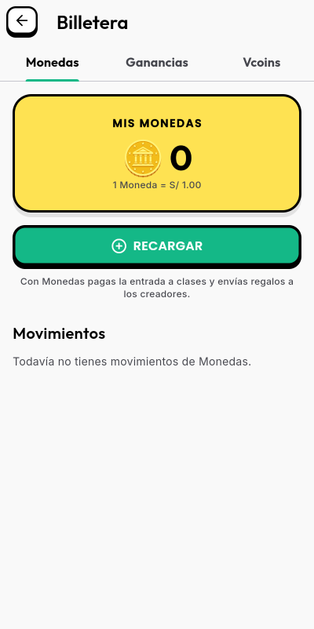
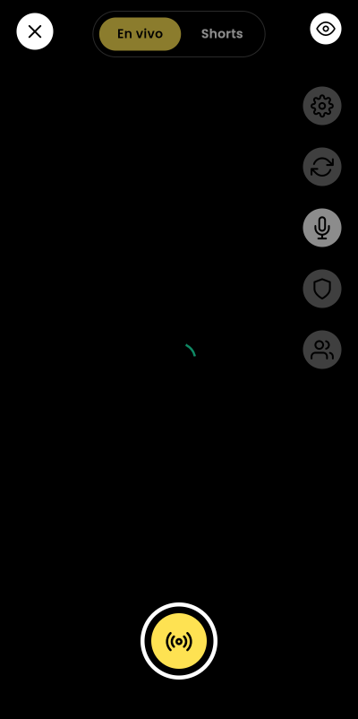
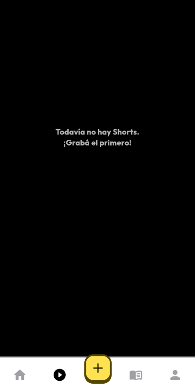

# Estudio de la app Estud-IA en local (2026-11-17)

**Cómo se hizo:** la app corría como Flutter web en `localhost` y la recorrimos con el MCP de Chrome
DevTools: capturas, árbol de accesibilidad y navegación. También revisamos el repo
`streaming-estudia`: `README.md`, `docs/01-producto/`, `docs/04-roadmap/README.md`,
`docs/05-diseno/design-system.md` y `Frontend/lib/src/shared/theme/app_colors.dart`.

**Para qué sirve:** registrar el estado de la app que promocionamos en esa fecha. El resumen vigente
para la landing está en [`../01-producto/app-estudia.md`](../01-producto/app-estudia.md).

## Datos técnicos que afectan a la landing

- **Renderizado con CanvasKit:** todo se dibuja en un `<canvas>`, así que no hay CSS que leer. La
  paleta se confirmó comparando capturas con `app_colors.dart`, y coinciden.
- **El árbol de accesibilidad de Flutter** solo aparece al pulsar "Enable accessibility". Varios
  botones (la barra inferior, los botones del perfil) **no tienen etiqueta accesible**: el lector de
  pantalla dice solo "botón". Es un hallazgo para el equipo de la app.
- **No conviene incrustar la app web en la landing**: CanvasKit pesa varios MB.

## Pantallas recorridas

| Pantalla | Qué muestra | Observación |
|---|---|---|
| Inicio | Buscador de cuentas, "Explora transmisiones en vivo", "Recomendado para ti" (Shorts) | En local está vacía: sin directos ni Shorts |
| Perfil | Portada, avatar con insignia **NIVEL** amarilla, "Mis Shorts" + "Grabar", cursos, logros, canales seguidos | Nivel 1 y logros bloqueados en local |
| Billetera | Pestañas **Monedas / Ganancias / Vcoins**; tarjeta amarilla "MIS MONEDAS" con "1 Moneda = S/ 1.00"; botón esmeralda **RECARGAR** | La interfaz de monetización ya existe, pero el cobro con Yape está pendiente (fase 9 de la app) |
| Shorts | Feed a pantalla completa con fondo negro | Vacío en local |
| Academia | Tarjeta "Cursos: en desarrollo" | Está congelada; no se muestra en la landing |
| Estudio (botón **+**) | Fondo negro, selector "En vivo / Shorts", controles laterales (ajustes, voltear cámara, micrófono, moderación, espectadores), botón de transmitir amarillo con aro blanco | Al entrar pide la cámara. Salimos sin transmitir |

  

No se guardaron capturas de inicio, perfil ni Academia porque mostraban la foto y el nombre de una
cuenta real.

## Identidad visual confirmada

- **Fondo** `#F9F9F9` y **tarjetas blancas** con **borde negro grueso** y **sombra dura** sin
  difuminado.
- **Amarillo `#FEE252`** en los elementos protagonistas: el botón **+** central, la insignia de
  nivel, la tarjeta de Monedas y el icono de Academia. El borde es oliva oscuro, no negro.
- **Esmeralda `#14B887`** para la acción: RECARGAR, "+ Grabar", "Ver todo", la pestaña activa.
- **Rojo `#BA1A1A`** para EN VIVO.
- **Tipografías:** Outfit en títulos, Inter en texto. Poppins casi no aparece.
- **Dos ambientes:** claro (inicio, perfil, billetera) y **negro total** (Shorts, estudio, directo).

## Conclusiones para la landing

1. **El cuello de botella es el material, no el código.** La app vacía no sirve para grabar. Se
   necesitan datos de demo o pantallas recreadas en HTML. Ver la decisión A1 en
   [`../03-arquitectura/riesgos.md`](../03-arquitectura/riesgos.md).
2. **El ritmo de la landing imita los dos ambientes de la app:** secciones claras y secciones negras.
3. **El botón amarillo "+"** (cuadrado redondeado con sombra dura) es el icono visual de la marca.
4. **Creadores:** la interfaz de Monedas, Ganancias y regalos ya existe. Se puede anunciar
   "Próximamente: cobra con Yape".
5. **Tono:** la app mezcla voseo ("¡Grabá el primero!") y tuteo ("puedes ver"). La landing usa
   **tú**. Ver [`../01-producto/mensajes-y-tono.md`](../01-producto/mensajes-y-tono.md).
