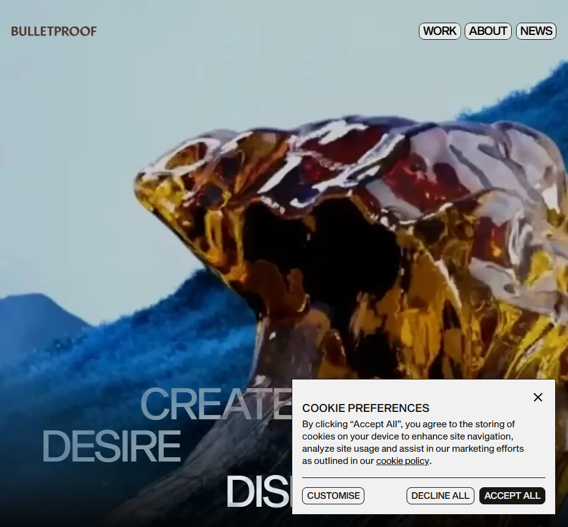
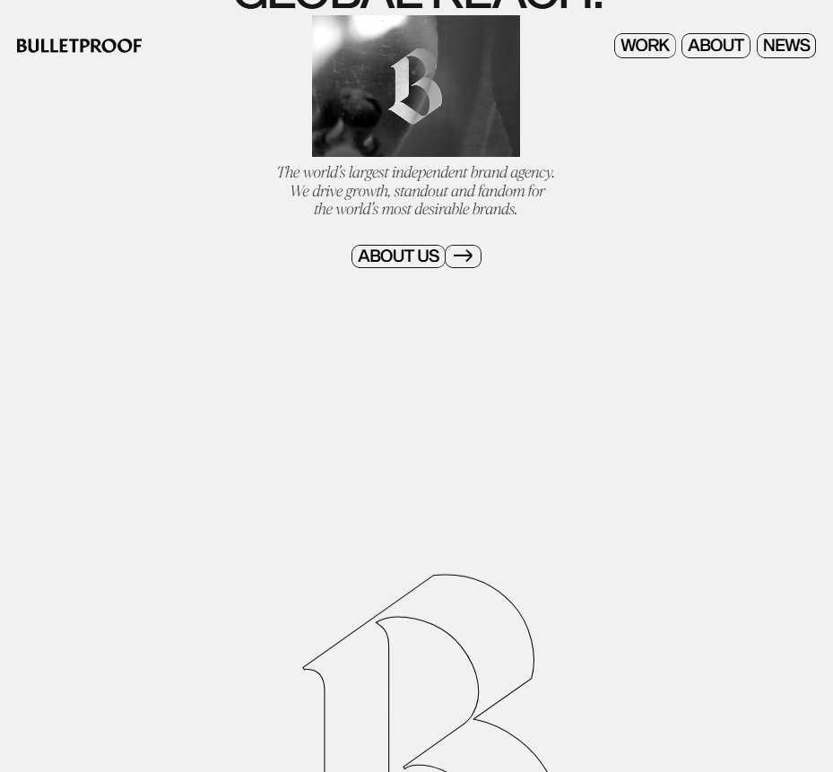

# Estudio de referencia: wearebulletproof.com

**Fecha del análisis:** 2026-11-17. Lo hicimos con el MCP de Chrome DevTools, inspeccionando
scripts, CSS, DOM y red, y recorriendo la página con scroll.

**Para qué sirve este documento:** registrar cómo está hecha la landing que tomamos como referencia
de *acabado* y *movimiento*, y qué tomamos de ella y qué no. Las decisiones que salen de aquí están
en [`../03-arquitectura/README.md`](../03-arquitectura/README.md).

## Cómo está construida

**Webflow + un bundle propio servido desde Vercel.**

- **Webflow** genera el HTML y el CSS base y gestiona el contenido (proyectos, noticias): de ahí los
  atributos `data-wf-*`, jQuery y `webflow.js`.
- **La parte creativa es código propio**: `bulletproof-webflow.vercel.app/app.js` (~197 KB) e
  `index.css` (~28 KB). Es un proyecto **Vite** que se compila aparte y se inyecta en Webflow con
  un `<script>`. El diseñador edita en Webflow y el desarrollador programa en un repo normal.
- **Código dividido en módulos** que se cargan cuando hacen falta. Los nombres de los ficheros:
  `Title`, `SplitOnResize`, `Locations`, `SmoothSlider`, `HideNav`, `HomeWorkListToCase`,
  `FullScreenSliderToCase`, `DefaultLeave`, `RebuildOnResize`, entre otros.
- **El HTML activa los módulos con atributos**: `data-module="SmoothSlider"`,
  `data-reveal="left"`.

## Librerías detectadas

| Librería | Versión | Uso |
|---|---|---|
| GSAP | 3.12.5 | Motor de todas las animaciones |
| ScrollTrigger | — | Animaciones ligadas al scroll: las líneas del titular se desplazan en horizontal (`translate3d(±vw)`) |
| SplitText | — | Divide los titulares en letras o líneas; `SplitOnResize` los vuelve a dividir al cambiar el tamaño |
| Flip | — | La miniatura de un proyecto "vuela" hasta la portada de la página del caso |
| CustomEase | — | Curvas propias, sobre todo `cubic-bezier(.84,0,.16,1)` |
| Lenis | — | Scroll suave con inercia (clase `lenis` en `<html>`) |
| Barba.js | — | Transiciones entre páginas sin recargar (`data-barba="wrapper"`/`container`, `namespace` por tipo de página) |
| Cloudflare Stream (HLS) | — | Videos de fondo con `data-src` → `src` en `blob:` solo al acercarse a la vista, con póster |
| Finsweet Cookie Consent | 1 | Banner de cookies |
| GTM, Clarity, Meta, LinkedIn, X | — | Analítica, cargada en diferido hasta la primera interacción |

## Trucos visuales

1. **Tipografía gigante y apretada:** `h1` de ~7,6vw, `line-height` 0,8 y `letter-spacing` −0,09em.
   Combina Sequel Sans con Mixta Pro Light Italic en los textos secundarios. Las dos son fuentes de
   pago.
2. **Logo y menú con `mix-blend-mode: difference`**: se invierten solos y se leen sobre cualquier
   fondo.
3. **`multiply` sobre el video del hero**, para fundirlo con el fondo.
4. **Secciones fijas (`position: sticky`) + ScrollTrigger** en el carrusel de proyectos. Hay un
   indicador de progreso controlado con la variable CSS `--progress`.
5. **Paleta mínima:** `#f1f1f1`, negro, botones en píldora con borde fino. El color lo ponen los
   videos.
6. **Variable `--vh` calculada con JS**, para la altura real de la ventana en móvil.

## Qué tomamos y qué no

| De Bulletproof | Decisión para Estud-IA | Motivo |
|---|---|---|
| GSAP + ScrollTrigger + SplitText + CustomEase | **Se toma** | Es lo que da el acabado. Desde GSAP 3.13 todos los plugins son gratis |
| Lenis | **Se toma** | Scroll suave sincronizado con ScrollTrigger |
| Un módulo por efecto, activado por `data-*` | **Se toma** | Cada efecto queda aislado, reutilizable y fácil de desactivar |
| Titular gigante que se mueve con el scroll | **Se toma**, con Outfit | La coreografía es la referencia |
| Secciones fijas que cuentan una historia | **Se toma** (el teléfono fijo) | Es el núcleo de "Así se vive una clase" |
| `mix-blend-mode: difference` en la navegación | **Se toma** | La landing alterna fondos claros y negros |
| Webflow | **No** → Astro | Somos desarrolladores; no necesitamos un CMS visual |
| Barba.js | **No** | Es casi una sola página. Si hace falta, View Transitions |
| HLS con Cloudflare Stream | **No** → MP4/WebM cortos | Son pocos videos de 5 a 10 s |
| Estética editorial y oscura | **No** → estilo táctil de la app | La landing debe parecerse a la app que se descarga |
| Sequel Sans, Mixta Pro, videos, logo | **No** | Son recursos con licencia o de su propiedad |
| 5 píxeles de seguimiento | **No** → una analítica ligera | Solo medimos descargas |
